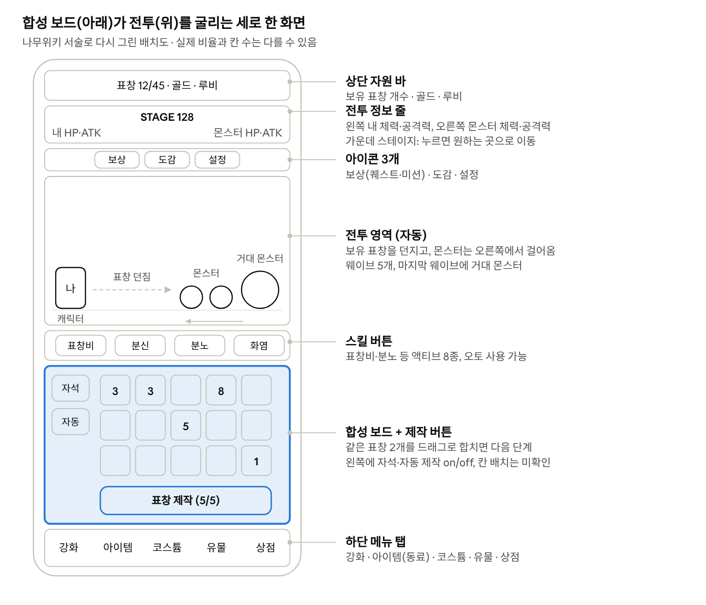
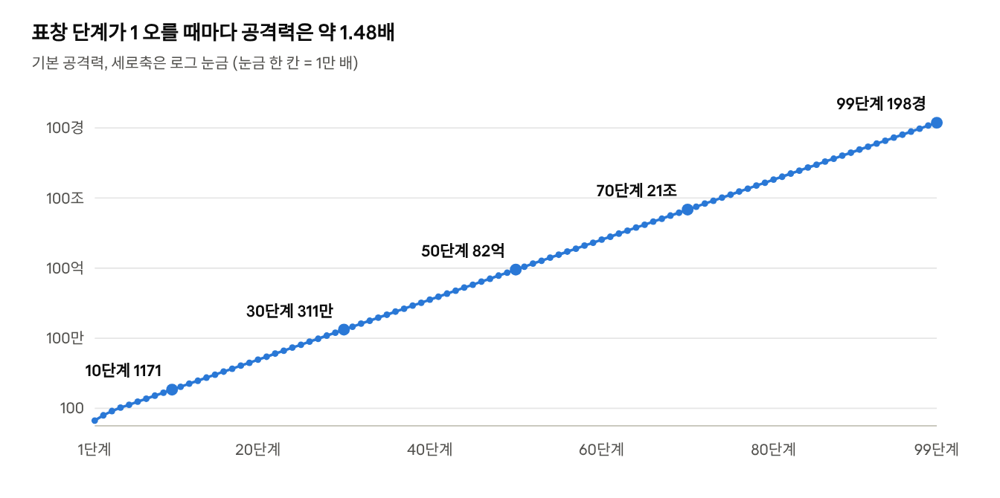

> 이 문서는 조승혁이 정리한 원작(표창키우기2) 분석 자료를 Word 파일에서 옮긴 것이다. 게임을 만들 때 참고만 하고, 이름, 그림, 문구는 원작 것을 쓰지 않는다.

# 표창키우기2 분석 --- 개인 프로젝트 기획 참고

Oct 15, 2026 · \@조승혁

## 한눈에 보기

표창키우기2는 아래 보드에서 표창을 만들고 같은 것 2개를 합쳐 키우면, 위 화면의 캐릭터가 그 표창을 자동으로 던져 사냥하는 **도트 방치형 합성 RPG**야. 마우스덕(김명준)이 2018-02-17에 안드로이드·iOS로 냈고, 2026년까지 계속 업데이트 중이야. 앱스토어 평점은 4.7(1.8만 개)이고, 스토어 설명엔 500만 명이 했다고 적혀 있어.

**핵심 루프:** 표창 제작 → 같은 표창 2개 드래그 합성 → 전투 자동 진행 → 골드 획득 → 능력치 강화 → 더 높은 스테이지.

**전작과 차이:** 1편은 표창을 다 던져 소모하면 끝이었는데, 2편은 RPG 요소가 들어가서 **캐릭터 체력이 버티는 데까지가 스테이지 한계**야. 전투하면서 동시에 표창을 키울 수 있는 것도 2편부터야.

**읽을 때 주의:** 숫자 대부분은 나무위키(최근 수정 2026-08-21)와 2019년 판본을 비교해서 뽑은 거야. 공식 수치가 아니고, 패치로 계속 바뀌었어. 내가 추측한 건 **(추정)**, 못 찾은 건 맨 아래 \"확인 못 한 것\"에 따로 모았어.

## 1. 화면 구성

세로 한 화면에 **위는 자동 전투, 아래는 합성 보드**가 동시에 돌아가. 보스전·던전 같은 콘텐츠에 들어가면 합성 보드는 사라져.

화면 배치도 · 나무위키 서술로 재구성, 실제 비율과 다를 수 있음

실제 스크린샷은 저작권 때문에 여기 못 넣었어. [App Store 페이지](https://apps.apple.com/kr/app/%ED%91%9C%EC%B0%BD%ED%82%A4%EC%9A%B0%EA%B8%B02/id1351322758) 스크린샷 옆에 이 배치도를 뒤서 비교해봐. 콘텐츠 버튼(보스·방어전 등) 위치는 자료에 없어.

## 2. 합성 보드

칸이 고정된 격자라기보다 **\"보유할 수 있는 표창 개수\"로 제한**되는 구조야. 시작은 5개, 골드로 늘려서 지금 기준 최대 65개까지.

  ---------------------------------------------------------------------------------------------------------------------------------------------------------------------
  항목                                내용
  ----------------------------------- ---------------------------------------------------------------------------------------------------------------------------------
  칸 수                               가로×세로 격자 크기는 공개 자료 없음. 보유 개수 = 5 + 레벨 (골드 업그레이드, 최대 60레벨 → 65개. 2019년엔 최대 45레벨 → 50개)

  제작 비용                           골드·재화 비용 언급 없음 → **무료 + 시간 제한**으로 보임 (추정)

  제작 쿨타임                         5 − 0.1 × 레벨 초 (최대 45레벨 → 0.5초)

  제작 최대치                         5 + 레벨 (최대 40레벨 → 45). 모아둘 수 있는 제작 횟수, 즉 충전식으로 보임 (추정)

  합성 규칙                           **같은 표창 2개 → 다음 단계 1개.** 2019년 문서에 \"38단계를 만들려면 1단계가 2\^37개 필요\"라고 계산돼 있어서 2개 합성이 확실해

  최대 단계                           지금 **144단계**. 출시 30 → 38 → 50 → 72 → 144로 늘어났고, 2026-10-08 업데이트에서 4종 더 추가 (2026년에만 신규 표창 16종)

  보드가 가득 차면                    문서에 없음. 더 못 만드는 것으로 보임 (추정)

  자동 합성 (자석)                    루비로 구매. 8.5 − 0.1 × 레벨 초마다 자동 합성, 최대 55레벨

  자동 제작                           루비로 구매. 같은 공식, 최대 55레벨

  합성 잠금                           최고 표창이 30단계 이상이면 도감에서 특정 표창을 잠가서 자동 합성에서 빼둘 수 있음
  ---------------------------------------------------------------------------------------------------------------------------------------------------------------------

**제작술**이 이 보드의 진짜 핵심이야. 표창을 만들 때 일정 확률로 1단계가 아니라 더 높은 단계 표창이 바로 튀어나와. 확률은 10 + 0.1 × 레벨 %이고, 단계는 104까지 있어 (자세한 건 \"그 외 특별한 정보\").

## 3. 표창의 공격 방식

장착 슬롯 없이 캐릭터가 **보드에 있는 표창을 그대로 던져.** 게임 안 안내 문구도 \"사냥은 내가 가지고 있는 표창을 날려요\"야.

-   보유 표창을 다 던지면 짧은 쿨타임 → 그동안 무방비

-   어떤 표창부터, 한 번에 몇 개 던지는지는 자료 없음

-   기본 발사 속도 수치 없음. 공격속도는 고급 유물(+1%/레벨, 최대 30), 아우라(최대 +9%), 스킬 분노로 올림

-   관통: 기본은 앞 1마리만 맞힘. 한계돌파 30레벨마다 관통 +1

-   던질 때 확률 효과: 표창 각성(파워샷·더블\~퀸터플샷), 표창마다 붙는 특수능력(넉백·스턴 등)

-   모양: 단계마다 이름과 도트가 다름 (기본 → 나무 → 티타늄 → 레드샤프 → 나이프 ...). 한계돌파 30레벨마다 오라 효과

나무위키 표창 도감 공식으로 계산 · 1\~99단계 (100단계 이후 수치 미공개)

**공식:** 1\~4단계는 20, 40, 70, 110이고, 그 뒤로는 ×16/11(약 1.45)과 ×121/80(약 1.51)을 번갈아 곱해. 그래서 짝수 단계로 합칠 때 오르는 폭이 조금 더 커.

**설계 포인트:** 2개를 합쳐도 공격력은 2배가 아니라 약 1.48배야. 총 화력만 보면 손해인데도 합치는 이유는 보유 칸이 제한돼 있고, 몬스터 체력이 N²로 커져서 한 발의 세기가 중요해지기 때문이야.

## 4. 표창 조각

합칠 때마다 **(표창구매 레벨) × (합친 표창 단계)** 개가 나와. 예를 들어 구매 레벨 3에서 10단계 2개를 합치면 30개.

-   배율: 제작술이 발동해서 만든 표창이면 2배, 제작술 버닝 중엔 3배, 유물 \"번영의 고대 동전\"이 레벨 × 2% 확률로 2배

-   황금 표창조각: 합성할 때 따로 나오고 기본 능력치 올리는 데만 씀 (나오는 양은 자료 없음)

-   쓰는 곳: 표창 구매, 기본 능력치 증가, 표창 보유 개수 증가, 표창 구매 할인

**표창 구매 (조각 상점)**

  ----------------------------------------------------------------------------------------------------------------------------------------------------------
  항목                                내용
  ----------------------------------- ----------------------------------------------------------------------------------------------------------------------
  슬롯                                랜덤 표창이 뜨고 각각 1번만 구매. 기본 3칸, 루비로 7칸 추가 (1000 → 2000 → ... → 64000, 2배씩)

  가격                                시작은 10단계 파이렛표창 = 조각 1000개. 1단계 높을 때마다 2배

  구매 레벨                           산 표창의 단계 수만큼 경험치 (10단계 = 10, 11단계 = 11). 레벨 1 오를 때마다 1단계 더 높은 표창 해금 + 가격 소폭 할인

  목록 새로고침                       첫 회 조각 1000개, 할 때마다 2배 (2019년엔 30분마다 1회 무료, 최대 5회 충전)
  ----------------------------------------------------------------------------------------------------------------------------------------------------------

경험치 차이가 1밖에 안 나서, 레벨 올릴 땐 싼 낮은 단계 표창을 사는 게 효율적이야.

## 5. 스테이지와 전투

한 스테이지는 **웨이브 5개**(N-1 \~ N-5)로 나뉘고, 마지막 웨이브에 덩치 크고 체력이 몇 배인 **거대 몬스터가 1마리** 나와. 거대 몬스터는 골드를 많이 주고 확률로 루비·에메랄드 1개를 떨궈.

-   웨이브당 몬스터 수: 자료 없음

-   몬스터 공식: **체력 = N² × c, 공격력 = N²** (N = 스테이지, c는 배경마다 다름. 2019년엔 c = 25)

-   스테이지 상한: 없음. 끝없이 올라감

-   배경 테마: 1\~19 동물, 20\~39 슬라임, 40\~79 골렘, 80\~159 동굴... 처럼 **구간 길이가 2배씩** 늘어나다가 3만대부터 불규칙해짐. 테마마다 몬스터 7종, 지금 252종

**실제 수치 예시** (2019년 방어전 몬스터, 1마리 기준)

  ------------------------------------------------------------------------
  스테이지                      체력                          공격력
  ----------------------------- ----------------------------- ------------
  1                             25                            1

  20                            22,500                        900

  160                           810,000                       32,400

  640                           2,722,500                     108,900

  1280                          86,583,025                    3,463,321
  ------------------------------------------------------------------------

**보스:** 메인 스테이지에 \"몇 스테이지마다 보스\"가 나오는 구조가 아니야. 각 스테이지의 거대 몬스터가 미니 보스 역할이고, 진짜 보스는 **별도 \"보스전\" 콘텐츠**(9\~15 참고)로 빠져 있어.

**캐릭터 체력이 깎이는 방식:** 몬스터가 오른쪽에서 걸어와서 때려. 시간제 아님. 보유 표창을 다 던지면 짧은 쿨타임이 생기는데, 이때 무방비라 후반엔 \"밀려서 다굴 맞고 죽는\" 경우가 많대. 넉백(동료 곰새마리, 특수능력)으로 밀어낼 수 있어.

**죽으면:** 처리 방식은 자료에 안 나와. 다만 \"죽은 횟수\"를 세는 시스템이 있고, 스테이지 간판을 눌러 원하는 스테이지로 직접 이동할 수 있어 (화살표 1개 = ±1, 2개 = ±10). 위키 팁은 막혀도 뒤로 돌아가지 말고 스킬 몰아 쓰기로 버티라고 해.

**등반술:** 스테이지 클리어 시 확률(10 + 0.1 × 레벨 %)로 스테이지를 추가로 +1 \~ +20 건너뛰어.

## 6. 재화

재화가 **16종 이상**이고, 거의 \"콘텐츠 1개 = 전용 재화 1개\" 구조야. 첫 버전엔 위 4줄(골드·루비·에메랄드·표창조각)이면 충분해.

  ------------------------------------------------------------------------------------------------------------------------------------------------
  재화                    얻는 곳                                                쓰는 곳
  ----------------------- ------------------------------------------------------ -----------------------------------------------------------------
  골드                    몬스터 사냥, 골드 광산, 콘텐츠 보상                    기본 능력치, 표창 보유 개수, 제작 시간 감소, 제작 최대치

  루비                    보스전, 방어전, 광고, 퀘스트, 거대 몬스터 드랍, 채굴   능력치, 유물 뽑기, 동료, 특수능력, 코스튬, 자석·자동 제작, 슬롯

  에메랄드                보스전, 방어전, 거대 몬스터 드랍, 채굴                 액티브 스킬, 제작술, 등반술

  표창조각                표창 합성                                              표창 구매, 능력치, 보유 개수, 구매 할인

  황금 표창조각           표창 합성                                              기본 능력치

  다이아몬드              던전, 광고                                             동료 진화, 고급 유물

  드래곤볼                드래곤전, 광고                                         동료 진화, 스톤(능력치)

  피닉스깃털              공중전, 광고                                           표창 각성, 캐릭터 각성, 동료 진화

  철광석                  광산, 스테이지 클리어(두덕쥐)                          한계돌파, 특수 유물

  시간의 조각             시간의 방, 광고                                        아우라 구입·강화

  볼트                    추격전                                                 자동차 구입·강화

  진주                    수중전, 광고                                           수중펫 구입·강화

  다크 스톤               블랙 드래곤                                            강화, 장비, 스킬 각성

  각성석                  크리스탈 드래곤                                        스킬 각성·강화

  악몽의 파편             악몽의 탑                                              전용 상점 교환

  별빛 조각               별빛극장                                               전용 상점 교환

  실크                    환영누각                                               레전드 코스튬 강화
  ------------------------------------------------------------------------------------------------------------------------------------------------

골드는 원래 결제로 못 사는 유일한 재화였어. 패키지에 \"모래시계\"도 보이는데 용도는 자료에 안 나와.

## 7. 영구 성장

기본 성장은 **골드 강화 5종 + 루비 강화 5종**이고, 나머지는 거의 다 \"공격력 %\"를 더하는 장치야. 아래는 2019년 판본 수치 (지금은 상한이 더 높아졌을 수 있음).

  ---------------------------------------------------------------------------------------
  재화              항목                 1레벨당                        최대 레벨
  ----------------- -------------------- ------------------------------ -----------------
  골드              공격력               레벨 ÷ 10 + 1 (내림)           5000

  골드              체력                 (레벨 ÷ 10 + 1) × 100 (내림)   5000

  골드              골드 획득량          +1                             1200

  골드              치명타 확률          +0.2%                          60

  골드              치명타 공격력        +1%                            60

  루비              추가 공격력          (레벨 + 1) × 5%                500

  루비              추가 체력            (레벨 + 1) × 2%                500

  루비              추가 골드            (레벨 + 1)%                    50

  루비              추가 치명타 확률     +0.4%                          30

  루비              추가 치명타 공격력   +4%                            30
  ---------------------------------------------------------------------------------------

**비용이 오르는 방식:** 위 항목의 가격표는 자료에 없어. 대신 제작술·등반술 가격 공식은 나와 있는데, **레벨 L로 올리는 값 = 단계 계수 × L**이야. 즉 한 레벨 값은 일차로 늘고, 누적은 제곱으로 늘어 (제작술 1단계 계수 1 → 100레벨까지 총 5,050 에메랄드).

**공격력 %를 더하는 장치들**

-   드래곤볼 스톤: 파워 스톤 +5%/레벨, 헬스 스톤 +2%, 골드 스톤 +1%. 레벨업 비용 = 레벨 × 10 드래곤볼

-   코스튬: 루비 5개당 공격력 +1%. 장착 안 해도 보유만 하면 적용

-   유물: 하나 오를 때마다 공격력 +20% + 고유 효과

-   캐릭터 각성: 피닉스깃털로 6개 능력치를 100레벨까지 → 등급 승급 (9\~15 참고)

대부분 **합연산**이고, 레전드 코스튬만 곱연산이야.

## 8. 방치 보상

앱을 끈 동안 쌓이는 **오프라인 보상은 자료에서 확인이 안 돼.** 이 게임의 \"방치\"는 **앱을 켜둔 채** 자석 + 자동 제작 + 오토 스킬로 굴리는 실시간 방치야. 위키도 폰보다 PC 버전 켜두기를 권하고, 설정에 \"번인 방지\"가 있는 것도 화면 켜둔 방치를 전제로 한 거야.

켜둔 동안 쌓이는 것들:

  -------------------------------------------------------------------------------------------------
  항목                    공식                         만렙 기준
  ----------------------- ---------------------------- --------------------------------------------
  루비 채굴               (330 − 5 × 레벨)초마다 1개   30레벨 → 180초마다 1개, 10시간에 약 200개

  에메랄드 채굴           (330 − 5 × 레벨)초마다 2개   60레벨 → 30초마다 2개, 10시간에 약 2,400개

  시간의 방 입장권        시간 따라 충전               최대 200회까지 누적
  -------------------------------------------------------------------------------------------------

-   채굴은 원래 손으로 눌러야 받았는데, 패치로 자동 수령이 됐어

-   인터넷 연결 시 약 30분마다 자동 클라우드 저장

-   오프라인 상한: 자료 없음

## 9\~15. 두 번째 단계에서 쓸 것

### 9. 동료

**6명**이고 전부 루비로 해금해. 능력 2개를 20레벨까지 올리면 1차 진화, 2차부터는 레벨 대신 재화를 내. 진화는 **8차까지**, 가격은 6명 모두 같아. 위키 표현으로 \"동료키우기라는 말이 있을 정도\"로 비중이 커.

  --------------------------------------------------------------------------------------------------------------------------------------------
  동료              해금 (루비)       하는 일                                                             0차 → 8차
  ----------------- ----------------- ------------------------------------------------------------------- ------------------------------------
  몽키스패너        500               내가 공격할 때 확률로 스패너도 던짐 (관통, 최고 표창 공격력 기준)   확률 25% → 65%, 공격력 200% → 600%

  마스터키          1000              보물상자 자동 획득, 보상 2배, 특수 재화                             자동 획득 30% → 100%

  곰새마리          2000              받는 피해 감소 + 때린 몬스터 넉백                                   피해 감소 15% → 55%

  드래공주          4000              N번 공격마다 파이어볼                                               10회마다 600% → 2회마다 1800%

  두덕쥐            8000              스테이지 클리어 시 철광석, 광산 채굴량 증가                         100개 3% → 500개 11%

  치료하마          16000             일정 시간마다 HP 회복                                               5초마다 3% → 2초마다 6.2%
  --------------------------------------------------------------------------------------------------------------------------------------------

진화 비용: 1차 루비 2만 → 2차 루비 4만 + 다이아 6천 + 드래곤볼 3천 → 3차부터 피닉스깃털 추가 → 7차 다크스톤, 8차 각성석 추가 (8차 = 루비 5000만). 진화할 때마다 \"표창비에 스패너 추가\"처럼 **스킬과 엮이는 보너스**가 하나씩 붙어. 위키 추천 순서: 2차까지만 먼저, 두덕쥐 → 드래공주 → 마스터키 → 곰새마리.

### 10. 각성

**표창 각성** (피닉스깃털): 10레벨마다 \"던질 때 확률로 터지는 효과\"가 한 칸씩 올라가. 2025년 12월부터 모든 표창에 한 번에 적용돼.

  -------------------------------------------------------------------------------------
  레벨 구간               효과                                  오르는 폭
  ----------------------- ------------------------------------- -----------------------
  10 \~ 200               파워샷(2배 위력)·더블샷(2발) 번갈아   각 10%씩 → 둘 다 100%

  210 \~ 400              트리플샷(3발)                         5%씩 → 100%

  410 \~ 800              쿼드러플샷(4발)                       2.5%씩 → 100%

  810 \~ 1000             퀸터플샷(5발)                         5%씩 → 100%
  -------------------------------------------------------------------------------------

**캐릭터 각성** (2024년 5월 추가, 피닉스깃털): 공격력·최종 체력·치명타 데미지·골드 획득량·표창 공격력·스킬 데미지 6개를 올려. 6개 전부 100레벨이면 **등급이 오르고 레벨이 0으로 초기화**되는데, 쌓은 계수는 유지되고 공격력 증폭이 붙어 (F 0% → E 10% → ... → S 75% → SS 100% → SSS 125% → EX 150%).

### 11. 코스튬

**능력이 붙어.** 루비로 사고, 루비 5개당 공격력 +1% (예: 200루비 = +40%). 장착 안 해도 보유 효과가 전부 합쳐져서 아무거나 먼저 사도 돼.

-   종류: 헤어, 얼굴, 의상, 신발, 펫, 뱃지, 자동차, 아우라, 수중펫, 배경, 한정

-   가격대: 100루비(+20%) \~ 60,000루비(+12,000%)

-   해금 조건이 붙은 것: 기사 세트는 던전 30/60/120층, 번개의 신 세트는 공격력 200,000% 달성

-   자동차: 추격전 시간 +1 \~ +10초 추가

-   아우라: 시간의 조각으로 사고 키움. 공격속도(최대 9%), 표창 보유 개수, 콘텐츠 입장 횟수·시간 같은 실속 능력

-   한정 코스튬은 지금 마일리지 상점으로 옮겨짐. 페이스북 좋아요 보상 펫도 있음

### 12. 추격전, 광산, 보스전, 방어전 + 그 외 콘텐츠

콘텐츠가 **14종**이고, 대부분 한 번 깬 단계는 **스킵**(자동 클리어)돼.

  ------------------------------------------------------------------------------------------------------------------------------------------------------------------------------------------------------------------
  콘텐츠                 규칙                                                                                                   입장 제한                          보상
  ---------------------- ------------------------------------------------------------------------------------------------------ ---------------------------------- -------------------------------------------------
  보스전                 보스 79마리 순서대로. 회피·분열·소환·방어막·흡혈·즉사 등 보스마다 패턴 다름. 하드·헬 모드는 보상 4배   쿨타임 10분, 깬 보스는 자동 처리   루비·에메랄드 (첫 보스 2/8 → 마지막 801/12,480)

  방어전                 몰려오는 몬스터를 전부 잡으면 승리. 79단계                                                             쿨타임 10분                        보스전과 같은 표

  던전                   층마다 몬스터 8마리 + 스켈레톤 아처, 아처 잡으면 다음 층. 합성 보드는 사라짐                           하루 5회 (출석 시 리셋)            다이아몬드

  드래곤                 체력 무한 드래곤에게 50초 동안 데미지. 불덩이가 100만부터 2배씩 세짐                                   스킵 가능                          넣은 데미지 구간별 드래곤볼

  블랙·크리스탈 드래곤   블랙은 보호막(암살로 해제), 크리스탈은 스턴 불덩이                                                     위와 같음                          다크 스톤 / 각성석

  추격전                 차 타고 폭주 거북이 추격, 연료 = 제한 시간(기본 30초). 2025년 12월부터 탱크에 데미지 넣는 방식         총 5회 시도                        볼트

  공중전                 손가락으로 캐릭터 직접 조종하는 탄막 슈팅. 보스에 닿으면 즉사. 이지\~익스트림                          단계식 + 제한 시간                 피닉스깃털

  수중전                 터치로 떠오르는 플래피버드식. 산소통 +시간, 기뢰 −시간                                                 ---                                진주

  시간의 방              타임키퍼에게 표창 던지면 표창 단계만큼 획득                                                            최대 200회 누적                    시간의 조각

  철광석 광산            일렬로 늘어선 광석 부수기, 부서지면 더 단단해져서 부활                                                 하루 10분, 자유 입장               철광석

  골드 광산              1분 동안 광석 때리기, 1타마다 고정 골드                                                                하루 5회                           골드

  레이드                 보스 전부 연속, 중간에 특수능력 못 바꿈                                                                ---                                루비·에메랄드

  승급전                 아이언 \~ 캘러미티 31티어 × 3단계, 티어마다 체력 5배                                                   ---                                승급 코스튬, 최종 피해·표창 공격력

  악몽의 탑              층마다 기존 보스, 10층마다 전용 보스 나이트메어. 110층                                                 스킵 가능                          악몽의 파편 + 층별 재화

  별빛극장               4라인 위아래 이동, 몬스터 50마리 후 보스                                                               스킵 가능                          별빛 조각

  환영누각               구미호에게 데미지 (2026년 4월 추가)                                                                    스킵 가능                          실크
  ------------------------------------------------------------------------------------------------------------------------------------------------------------------------------------------------------------------

에메랄드·루비 광산은 2025년 12월에 삭제됐어.

### 13. 부가 요소

-   **광고:** 상점 무료 루비 2만(60분 쿨), 광고 보고 루비 6만(60분 쿨), 하루 6단계 광고 상품(루비 → 다이아 → 드래곤볼 → 깃털 → 모래시계 → 진주). 반복 퀘스트에도 \"광고 보기\"가 있음. 광고 제거 패키지 \$4.99

-   **출석:** 있음. 출석하면 던전 횟수와 버닝 가격이 리셋. 출석 보상 2배 패키지 \$4.99, 출석 수만큼 공격력 오르는 스톤도 있음

-   **퀘스트:** 일반 퀘스트(N번째 표창 = 루비 10N개, 스테이지 클리어 = 5개, 접속 10분·합성 500회·사냥 1500마리·제작 1500회·보스 100마리·방어 100회 = 각 50개) + **반복 퀘스트 9종 순환**(합성 → 사냥 → 스테이지 → 보스 → 방어 → 접속 → 보물상자 → 스킬 → 광고, 보상 퀘스트레벨 × 100루비, 한 바퀴 돌면 퀘스트레벨 +1)

-   **미션(가이드):** 초급 100, 중급 100, 상급 100, 상급2 50개. 가이드 98 클리어하면 채팅 해금 (2026년 1월)

-   **업적·랭킹:** 설정 메뉴 안에 있음

-   **상점:** 월간 패키지 \$9.99/\$29.99/\$89.99, 표창 패키지 \$9.99(최고 표창 3단계 오를 때마다 보상), 버닝 패키지 \$9.99(50일간 매일 루비 1만), 제작술·등반술 패키지, 마일리지(결제액 또는 루비 10개 = 1마일)

-   **뽑기:** 유물 = 루비 200개로 20종 중 랜덤 1개(종류당 최대 50개, 전부 모으면 루비 20만). 특수능력 = 루비 300개로 10개 중 고르기. 확률표는 자료 없음. 캐릭터·동료 가챠는 없음

-   **보물상자:** 전투 화면에 뜨고 터치해서 염. 마스터키가 자동으로 열어줌

### 14. 환생

**정통 환생(전부 초기화하고 다시 시작)은 없어.** 대신 비슷한 역할을 하는 게 둘 있어.

-   캐릭터 각성 등급 승급: 레벨만 0으로 돌리고 영구 증폭을 얻음 (10번 참고)

-   제작술 버닝 레벨: 10번 쓸 때마다 확률이 영구히 +0.1%, 최대 8000레벨까지 계속 쌓임

스테이지는 원하는 곳으로 자유롭게 이동 가능해서, 막히면 뒤로 가서 골드 버는 식의 플레이가 가능해.

### 15. 손맛

-   스토어 설명이 \"강렬한 타격감\"을 내세움. 도트 그래픽

-   **데미지 숫자 표시 있음:** 설정에 데미지 폰트 on/off가 있어

-   이펙트 on/off, 저사양 모드, 효과음·배경음 on/off도 있음 → 이펙트가 꽤 많다는 뜻

-   새 표창이 나올 때 쾌감이 크다는 리뷰가 있음. 도감 + \"N번째 표창\" 보상이 그걸 밀어줌

-   한계돌파 30레벨마다 표창에 오라 효과, 던전 들어가면 BGM이 바뀜, 치명타 있음

-   화면 흔들림, 합칠 때 이펙트·소리 디테일: 자료 없음

## 그 외 특별한 정보

목록에 없었는데 설계에 쓸 만한 장치들이야. 특히 앞의 3개가 \"합성 게임이 2\^n 지옥에 안 빠지게\" 막는 핵심이야.

### 2\^n 문제를 푸는 장치

2개씩 합치면 n단계 1개에 1단계가 2\^(n−1)개 필요해. 38단계면 1374억 개라서, 아래 장치들로 건너뛰게 만들었어.

-   **제작술** (에메랄드): 표창을 만들 때 확률로 더 높은 단계가 바로 나옴. 1단계 = 2단계 표창 제작, 2단계 = 3단계 표창... 식으로 104단계까지. 확률 10 + 0.1 × 레벨 %. 다음 단계 해금은 앞 단계 30\~80레벨, 10단계부터는 앞 단계 100레벨. 레벨당 가격 계수 1, 2, 4, 8, 16, 32, 44, 64, 92, 128 ... (단계마다 커짐). 위키 1순위 팁: 에메랄드는 제작술부터, 3단계 해금 후 집중

-   **합성술** (지금은 삭제): 같은 단계 2개를 합칠 때 확률로 3단계 위가 나옴. 확률 10 + 0.5 × 레벨 %

-   **제작술 버닝** (루비): 30초 동안 제작 무제한 + 자동 제작 + 조각 3배 + 제작술 +4단계 확률. 첫 회 무료, 이후 20루비씩 비싸지고 출석하면 가격 리셋. 10번 살 때마다 레벨업해서 확률이 영구히 +0.1% (최대 8000레벨)

### 전투 보조

-   **한계돌파** (철광석): 표창 기본 공격력 +1%/레벨, 최대 5000레벨. 진짜 핵심은 **30레벨마다 관통 +1** (300레벨에서 끝). 후반엔 몬스터 체력이 공격력보다 빨리 커서 원킬이 불가능해지는데, 관통이 없으면 앞 몬스터가 맞는 동안 뒤 몬스터가 그냥 걸어옴

-   **액티브 스킬 8종** (에메랄드, 앞 스킬 만렙이면 다음 해금, 오토 사용 가능): 표창비(60초 쿨, 57 + 3 × 레벨 개), 그림자 분신술(180초, 30 + 레벨 초 동안 그림자가 같이 던짐), 분노(180초, 공속·이속 대폭 상승), 화염의 표창(60초), 암살(30초, 빠른 2회 공격), 난사(45초), 뇌전 표창(60초), 어둠장막(60초). 각각 강화 → 각성 → 특수 강화 단계가 더 있음. 모든 계수는 최고 표창 공격력 기준 %

-   **특수능력** (루비 300개로 10개 중 선택): 표창마다 따로 붙음. 발동 6\~20%. 넉백, 스턴, 내 HP 회복, 몬스터 HP % 감소, 추가 데미지, 그리고 이것들의 조합

### \"모든 콘텐츠를 하게 만드는\" 장치

-   **드래곤볼 스톤 28종:** 한 번 사면 각 콘텐츠 최고 기록에 비례해 공격력이 계속 오름 (예: 라스트스톤 = 최고 스테이지 × 1%, 보스 스톤 = 보스 최고 단계 × 700,000%). 기록을 갱신하면 자동으로 따라 오름

-   **고급 유물** (다이아): 던전·드래곤·추격전 등 콘텐츠 입장 10회마다 공격력 증폭 약 0.024%

-   **일반 유물 20종:** 공격력 +20%/레벨에 고유 효과 하나씩 (체력, 골드, 치명타, 자동 제작 2개, 자석 2개 합성, 채굴 2배, 스킬 쿨 감소, 보스·방어전 보상 2배, 조각 2배 등)

### 운영·디테일

-   숫자가 만 → 억 → 조 → 경 → 해 → 자 → 양 → 구 → 간 → 정까지 한국식 큰 수 단위로 표시됨

-   표창 30단계 출시 후 2026년엔 144단계, 보스는 23마리 → 79마리. **계속 위로 덧붙이는 업데이트 구조**

-   카페 공모전으로 몬스터 테마·표창(라젠카표창)을 뽑음. 개발사 다른 게임 캐릭터(비둘기키우기의 비둘기)가 펫으로 나옴

-   전작보다 루비 수급을 줄여서 채굴 업그레이드 가치가 커짐

### 2026년에 새로 생긴 것 (위키에 아직 거의 없음)

App Store 업데이트 내역(최신 1.0.659, 2026-10-08)에만 나오는 시스템들이야. 세부 규칙은 자료가 없어.

-   **전직:** 4월에 추가, 10월에 5차 \"특급 닌자\"까지

-   **정령:** 7월 추가, 9월에 \"정령 탐사\" 콘텐츠와 정령 2차 진화

-   **길드:** 3월 추가 후 길드 미션·길드룸·길드 파견·길드 전략까지 확장

-   **표창 각인, 해체술, 하이퍼 버닝 강화, 승급 능력 각성**

-   **일일·주간 미션, 요일 반복 출석, 콘텐츠 프리셋**

-   시즌 이벤트가 거의 매달: 빙고, 주사위, 한가위 윷놀이, 7일 미션

## 확인 못 한 것

아래는 자료가 없어서 **직접 10분 플레이하면서 화면 녹화**로 확인하는 게 제일 빨라. 체크하면서 채워 넣어.

-   [ ] 합성 보드 격자 크기와 칸 배치 (스크린샷 1\~2장)

-   [ ] 표창 제작에 골드가 드는지, 정말 무료인지

-   [ ] 보드가 가득 찼을 때 제작 버튼 동작

-   [ ] 보드의 어떤 표창부터 던지는지, 한 번에 몇 개, 기본 발사 간격

-   [ ] 웨이브당 몬스터 수, 지금 버전의 체력 계수 c

-   [ ] 캐릭터가 죽으면 같은 스테이지 재시작인지, 뒤로 밀리는지

-   [ ] 앱 끄고 다시 켰을 때 오프라인 보상이 있는지, 상한 시간

-   [ ] 합칠 때 이펙트·소리, 화면 흔들림

-   [ ] 골드 강화 가격표 (레벨별 비용)

-   [ ] 유물 뽑기 확률

## 내 게임 MVP 제안

원작은 8년치 업데이트가 쌓인 게임이라, **\"만들기 → 합치기 → 던지기 → 골드 → 강화\" 한 바퀴만** 먼저 돌아가게 하자는 제안이야. 숫자는 원작 곡선을 참고해서 내가 잡은 시작값이고, 플레이해보면서 바꾸면 돼.

### v0.1 --- 핵심 루프만

1.  **보드:** 4 × 3 = 12칸, 시작은 8칸만 열림. 제작 버튼은 무료, 쿨타임 2초, 최대 5번 충전

2.  **합성:** 같은 단계 2개 → 다음 단계, 20단계까지. 공격력(n) = 20 × 1.48\^(n − 1) 반올림 (원작 곡선과 거의 같음)

3.  **던지기:** 캐릭터는 왼쪽 고정, 보드에서 가장 높은 단계부터 1개씩 던지고, 다 던지면 1초 재장전 (원작에서 확인 못 한 부분이라 내 안)

4.  **스테이지:** 웨이브 5개 × 몬스터 4마리, 마지막 웨이브에 거대 몬스터(체력 5배). 몬스터 체력 = 25 × N², 공격력 = N²

5.  **재화·강화:** 골드 하나. 공격력 +10%, 체력 +10% 두 개만. 가격 = 10 × 1.15\^레벨

6.  **죽으면:** 스테이지 −1로 내려가고 체력 회복 (원작 미확인, 내 안)

7.  **저장:** localStorage에 자동 저장

### v0.2 --- 방치 느낌 추가

자석·자동 제작, 표창 조각 + 조각 상점, 루비 + 보스전 1종, 스킬 2개(표창비, 분노), 오프라인 보상(최대 8시간)

### v0.3 --- 성장 깊이

동료 2명(몽키스패너형 추가타, 치료하마형 회복), 제작술, 표창 각성(파워샷·더블샷)

### 만들 때 미리 챙길 것

-   숫자가 경·해 단위까지 커지니까 **처음부터 큰 수 라이브러리**(break_infinity.js 같은 것) + 한국식 단위 포맷 함수 하나 만들어두기. 나중에 바꾸면 전부 갈아엎어야 해

-   네가 HTML/CSS가 강하니까 **보드는 DOM(CSS grid + 드래그), 전투는 canvas 하나**로 나누면 편해

-   이름·도트·보스 디자인은 원작 걸 쓰지 말고 메커니즘만 참고하기. 나중에 공개할 때 문제 안 생기게

## 출처

-   [나무위키 --- 표창키우기2](https://namu.wiki/w/%ED%91%9C%EC%B0%BD%ED%82%A4%EC%9A%B0%EA%B8%B02) (최근 수정 2026-08-21): 재화, 퀘스트, 도감, 강화, 각성, 동료, 코스튬, 유물, 상점, 팁

-   [나무위키 --- 표창키우기2/전투](https://namu.wiki/w/%ED%91%9C%EC%B0%BD%ED%82%A4%EC%9A%B0%EA%B8%B02/%EC%A0%84%ED%88%AC) (최근 수정 2026-09-07): 몬스터, 보스전, 방어전, 던전, 드래곤, 추격전, 공중전, 수중전, 광산, 승급전, 악몽의 탑 등

-   [나무위키 --- 표창키우기2 2019년 판본 (r562)](https://namu.wiki/w/%ED%91%9C%EC%B0%BD%ED%82%A4%EC%9A%B0%EA%B8%B02?uuid=9be97960-5243-47c4-ac2e-7d3a293a5119): 웨이브 구조, 몬스터 공식, 골드·루비 강화표, 방어전 몬스터 수치, 화면 구성

-   [App Store --- 표창키우기2](https://apps.apple.com/kr/app/%ED%91%9C%EC%B0%BD%ED%82%A4%EC%9A%B0%EA%B8%B02/id1351322758): 게임 설명, 평점, 2026년 업데이트 내역
